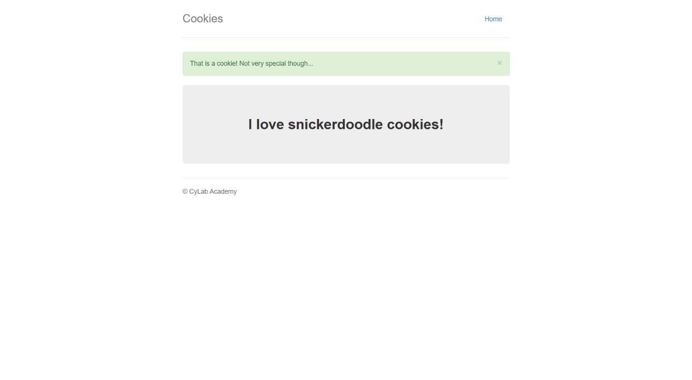

# Cookies

**Autor:** Otavio Faria  
**Categoria:** Web / Web Exploitation  
**Plataforma:** CyLab Security Academy  
**Desafio:** [Cookies](https://learn.cylabacademy.org/library/173)

## Objetivo

Explorar o comportamento do site de pesquisa de cookies e encontrar o valor que faz a aplicação mostrar a flag.

## Análise

Após iniciar a instância e pesquisar `snickerdoodle`, o servidor define o cookie `name=0` e redireciona para `/check`. A página mostra:

```text
That is a cookie! Not very special though...
I love snickerdoodle cookies!
```



O cookie `name` é enviado pelo cliente. Alterar seu valor permite testar como o servidor escolhe o conteúdo da resposta.

## Resolução

1. Abrir o desafio e clicar em **Launch Instance**.
2. Acessar a URL fornecida e pesquisar `snickerdoodle`.
3. Observar o redirecionamento para `/check` e o cookie `name=0`.
4. Fazer requisições para essa rota, alterando apenas o número do cookie `name`.
5. Verificar em qual resposta aparece a flag. Na instância analisada, isso ocorre com `name=18`.

Para testar o valor encontrado em um terminal:

```bash
curl -s -H 'Cookie: name=18' 'http://HOST:PORTA/check'
```

Substituir `HOST:PORTA` pela URL atual da instância. No Windows, usar `curl.exe` se `curl` for um atalho do PowerShell.

Para repetir a busca dos valores de 0 a 31:

```bash
python scripts/resolver.py cookies --url http://HOST:PORTA/
```

O script envia a pesquisa inicial, identifica a rota de redirecionamento e interrompe a busca assim que encontra uma flag. A execução registrada foi feita apenas contra a instância deste desafio.

## Resultado

```text
Rota após a pesquisa: /check
Cookie após a pesquisa: name=0
name=18: flag encontrada
Flag: academy{3v3ry1_l0v3s_c00k135_90a3a7cb}
```

[Registro da execução](../evidencias/cookies.txt).

## Conclusão

A aplicação permite selecionar a resposta que contém a flag por meio de um valor controlado pelo cliente. Em aplicações reais, dados sensíveis precisam de verificação de autorização no servidor; um cookie editável não comprova permissão.

**Observação:** a instância é temporária. Nesta versão do CyLab, a rota verificada é `/check`; tutoriais antigos podem apresentar `/show`.
