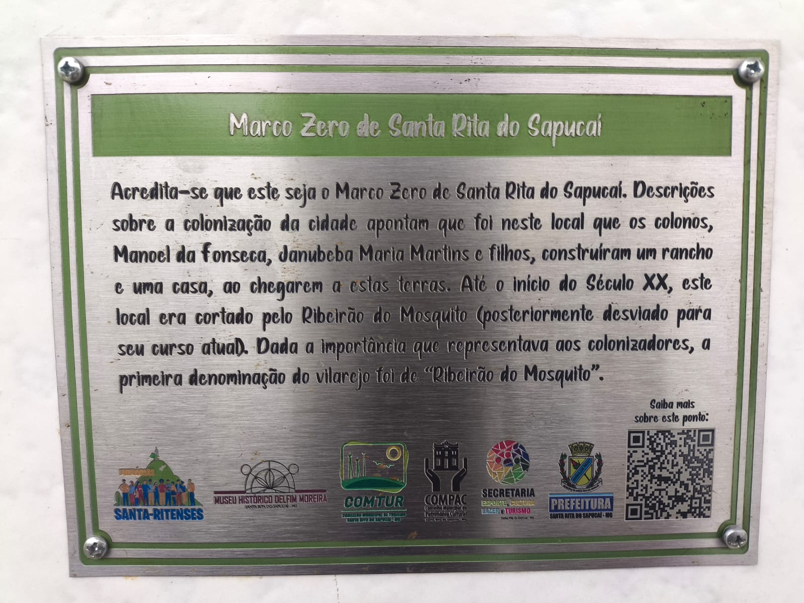
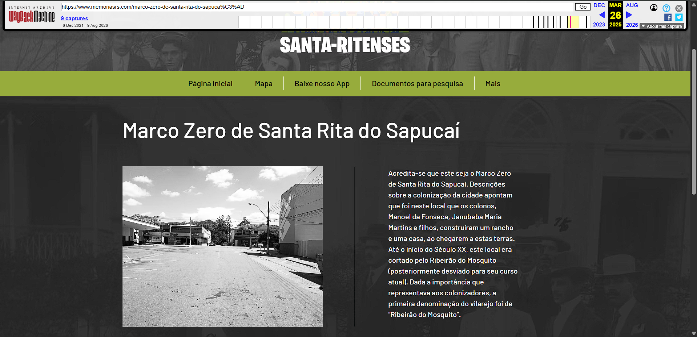

# 404: origem perdida

**Autor:** Otavio Faria

**Categoria:** OSINT  
**Pontuação:** 100  
**Plataforma:** Escolinha CTF  

## Enunciado

> O ponto zero de uma cidade sem memórias, apenas uma pequena placa de metal antigo marca o local. Acredita-se que naquela alameda foi onde começou o vilarejo de Ribeirão do mosquito que depois cresceu para se tornar um dos maiores polos eletrônicos do país.
>
> Porém, nada escapa do tempo irrefreável, nem mesmo o começo pode escapar do esquecimento. Cabe a você descobrir, onde está a origem?
>
> **Formato da flag:** `FLAG{NOME_DO_LOCAL}`

O desafio também disponibiliza o arquivo `placa.jpeg`.




## Análise

A descrição aponta para a origem de Santa Rita do Sapucaí, antiga Ribeirão do Mosquito. Na placa havia um QR Code; ao lê-lo, cheguei a uma página que já estava indisponível (https://www.memoriasrs.com//marco-zero-de-santa-rita-do-sapuca%c3%ad). Em vez de abandonar a pista, procurei uma cópia histórica do endereço na Wayback Machine.

Ao abrir a versão antiga dessa url, o site já estava aberto em uma pagina contendo uma imagem e o exato texto apresentado na **placa da questão**.



Com essa referência, comparei fachada, rua e estabelecimentos próximos no Google Maps/Street View. A placa fica em frente à **Casa Miranda**. Como a evidência visual já aparece na página arquivada, não incluí uma terceira captura apenas para repetir a confirmação.

## Flag

```text
FLAG{CASA_MIRANDA}
```

## Conclusão

O desafio mostra uma situação comum em OSINT: a fonte original deixou de existir, mas ainda havia material suficiente em arquivos da web para reconstruir a pista. A checagem no mapa foi importante para não depender apenas de uma interpretação da imagem.
