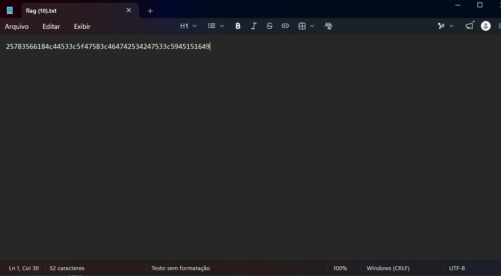
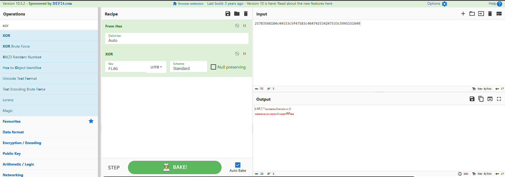
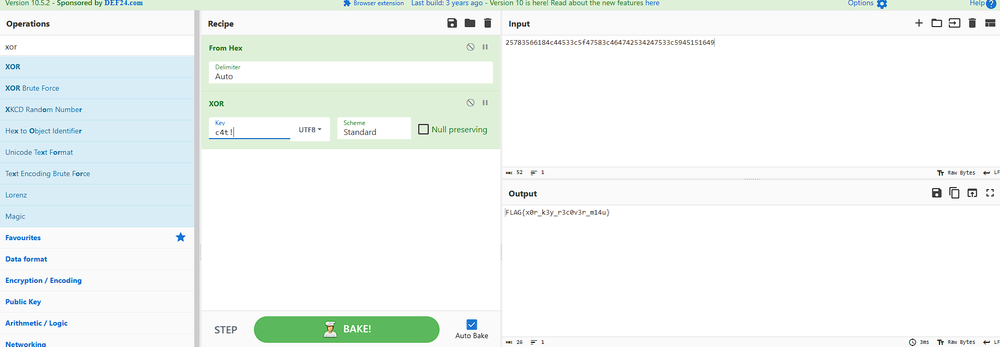

# Acesso exclusivo

**Autor:** Otavio Faria

**Categoria:** Cripto  
**Pontuação:** 500  
**Plataforma:** Escolinha CTF  

## Enunciado

> A lógica do algoritmo invasor é simples: “ou é uma coisa, ou é outra, mas nunca as duas”. Use esse conhecimento contra a própria cifra para quebrar a criptografia.
>
> **Modelo de flag:** `FLAG{...}`

O arquivo disponibilizado pelo desafio, `flag.txt`, contém:

```text
25783566184c44533c5f47583c464742534247533c5945151649
```



## Análise

A dica leva à operação XOR (*exclusive or*). A característica útil aqui é que, quando uma mensagem é cifrada com XOR, a mesma chave também serve para desfazer a cifra.

```text
texto_claro XOR chave = texto_cifrado
texto_cifrado XOR chave = texto_claro
```

O desafio não informa a chave, mas informa o padrão da resposta: `FLAG{...}`. Logo, o início do texto original já é conhecido. Em vez de tentar adivinhar uma chave, usei `FLAG` no XOR para comparar esse trecho conhecido com o conteúdo do arquivo.

## Resolução

Primeiro, colei o conteúdo de `flag.txt` no CyberChef e adicionei `From Hex`, pois o arquivo está escrito em hexadecimal. Depois, incluí a operação `XOR`, selecionei `UTF8` e coloquei `FLAG` como chave. O início da saída foi `c4t!`, a chave curta usada para cifrar a flag, como mostrado na imagem em seguida.

```text
From Hex
XOR (Key: FLAG, UTF8, Scheme: Standard)
```



Com a chave descoberta, mantive `From Hex` e alterei apenas a chave da operação XOR para `c4t!`, também em UTF-8. Dessa vez, a saída revelou a flag completa.

```text
From Hex
XOR (Key: c4t!, UTF8, Scheme: Standard)
```



O resultado exibido foi:

```text
FLAG{x0r_k3y_r3c0v3r_m14u}
```

## Flag

```text
FLAG{x0r_k3y_r3c0v3r_m14u}
```

## Conclusão

O desafio ilustra um problema de usar XOR com uma chave curta e repetida. Como o formato da flag era conhecido, foi possível recuperar a chave a partir do começo do texto e reutilizá-la para ler a mensagem inteira.
