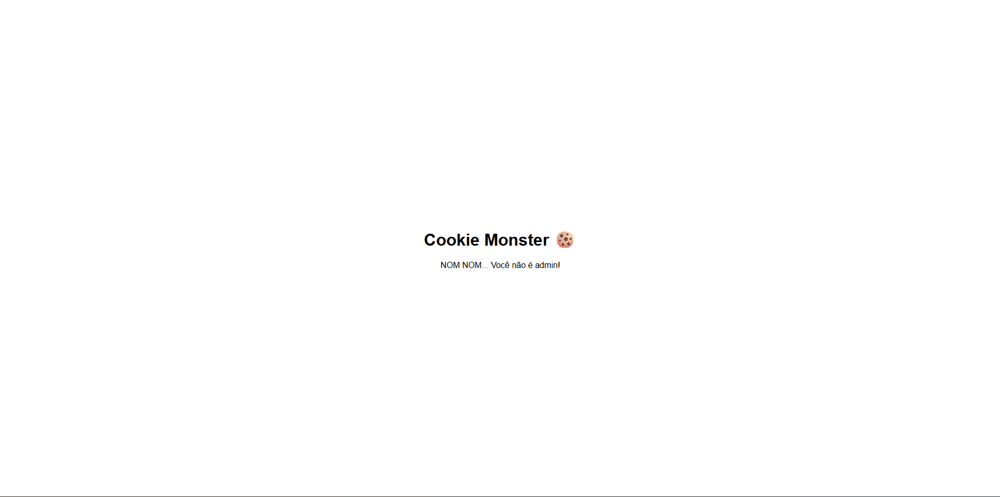
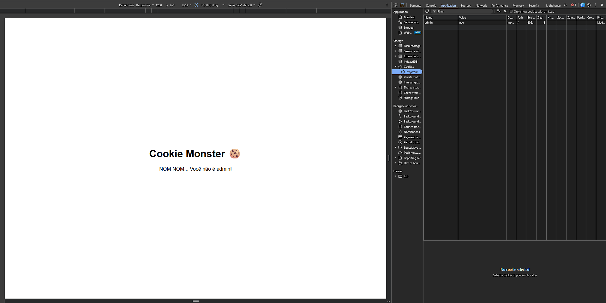

# Cookie Monster

**Autor:** Otavio Faria

**Categoria:** Web  
**Pontuação:** 500  
**Plataforma:** Escolinha CTF  

## Enunciado

> Acesse o site para obter a flag:
>
> **Modelo de flag:** `FLAG{...}`

Ao abrir a aplicação, a mensagem exibida é:

```text
NOM NOM... Você não é admin!
```



O nome do desafio sugere que o controle de acesso pode depender de cookies do navegador.

## Análise

No DevTools do navegador, em **Application > Cookies**, há um cookie chamado `admin` com o valor `nao`:

```text
admin=nao
```

Como esse valor fica no navegador, ele pode ser alterado pelo usuário. Se a aplicação confiar diretamente nele para decidir quem é administrador, o controle de acesso pode ser contornado.



## Resolução

No ambiente do desafio, executei os passos abaixo:

1. Abri as ferramentas de desenvolvedor do navegador (`F12`).
2. Acessei **Application > Cookies** e selecionei o domínio do desafio.
3. Editei o valor do cookie `admin` de `nao` para `sim`.
4. Recarreguei a página para que a nova requisição enviasse `admin=sim` ao servidor.

Após o recarregamento, a página liberou a mensagem de administrador e exibiu a flag.


## Flag

```text
FLAG{C00K1E_M0NST3R_MUNCH}
```

## Conclusão

Isso é um caso clássico de *Broken Access Control*. O problema não é o cookie existir, e sim o servidor confiar em uma informação que o usuário controla para decidir uma permissão. Em uma aplicação real, os privilégios devem ser validados no servidor, associados a uma sessão ou a um token cuja integridade seja verificada.
